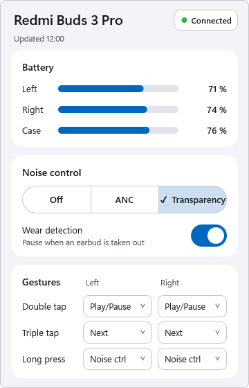
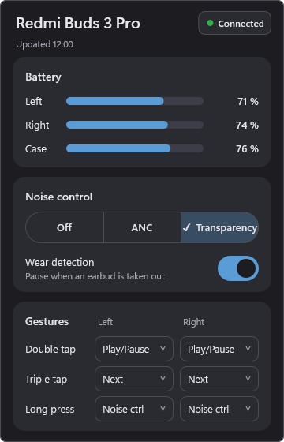

# redmibuds

A small, low-resource Windows tray app (and Rust library) for **Xiaomi Redmi Buds 3 Pro**:
battery of the left/right earbud and the case, noise control (Off / ANC / Transparency),
wear detection and tap gestures.

> Unofficial project, not affiliated with or endorsed by Xiaomi. "Xiaomi" and "Redmi" are
> trademarks of Xiaomi. The app uses no Xiaomi logos (the tray icon is a generated symbol).

 

- Tray icon coloured by the lowest earbud battery; tooltip with L / R / case and ANC mode.
- Left click: Material 3 style popup (Direct2D/DirectWrite), follows the Windows light/dark
  theme and accent colour. Right click: Refresh now / Start with Windows / Exit.
- Idle: ~3 MB working set, ~0 % CPU (event-driven, no polling). The popup window and its
  rendering resources exist only while it is open. Release exe ≈ 350 KB.

## Build

Requirements: [rustup](https://rustup.rs/) (e.g. `winget install Rustlang.Rustup`). No Visual Studio needed:
`rust-toolchain.toml` selects `stable-x86_64-pc-windows-gnu`, which ships its own linker.

```powershell
cargo test --lib
cargo build --release --bin redmibuds-tray
```

The `windows` crate is pinned to **0.58**: newer versions (and crates depending on them, e.g. Slint)
use `raw-dylib`, which on the GNU toolchain needs MinGW `dlltool` + `as`, which Rust does not ship.

## Run

```powershell
.\target\release\redmibuds-tray.exe
```

The earbuds must be paired with Windows. Other binaries:

- `probe` – one-shot connect, prints battery / ANC / gestures and raw frames in hex
- `anc_check` – hardware check: ANC on → transparency → off, with readback
- `apply_check` – setting changes through the same on-demand path as the tray app

The screenshots in `docs/` are rendered offscreen with sample data (no screen capture):

```powershell
cargo run --release --features render-docs --bin redmibuds-tray -- --render-docs docs
```

## Behaviour and caveats

- **One controller at a time.** The earbuds' control channel (RFCOMM `0000fd2d-…`) accepts only one
  client. The tray app therefore connects **on demand** (popup opened, setting changed, every 5 min
  while the earbuds are connected) and releases it ~1.5 s later. `HOLD_CONNECTION` in
  `src/bin/tray/app.rs` switches to a permanent connection.
- **MyBuds / Xiaomi Earbuds app.** While the phone app is open it holds the control channel; the
  popup shows "Busy (phone app?)". The phone's Bluetooth itself and audio playing from the phone
  do not block it.
- **ANC needs both earbuds in.** With only one earbud worn the earbuds reject ANC on
  (response status `0x09`) and switch ANC off themselves; the popup shows
  "Not applied – ANC needs both earbuds in". Transparency and Off work with one earbud.
- Unconfirmed changes (e.g. connection refused) are retried after 2, 4, 8 and 15 s.

## Log

`%LOCALAPPDATA%\redmibuds\redmibuds.log` – all frames (hex), connection errors, rejected commands.
Capped at 256 KB, rotated to `redmibuds.log.1`.

## Layout

- `src/frame.rs` – framing `FE DC BA | type | op | len | [status] | seq | payload | EF` + reassembly
- `src/auth.rs` – challenge/response cipher (Bluetooth SAFER+ variant)
- `src/protocol.rs` – session: auth, device/run info, battery, ANC, gestures, setters, acks, rejections
- `src/windows_bt.rs` – WinRT RFCOMM transport + diagnostics
- `src/client.rs` – background client (on-demand / hold), confirmation, retries
- `src/bin/tray/` – tray app (`app.rs`) and popup (`popup.rs`)

## Credits and license

The protocol (framing, authentication, battery/ANC/gesture decoding) is ported from
[Gadgetbridge](https://codeberg.org/Freeyourgadget/Gadgetbridge) (Redmi Buds support),
licensed AGPL-3.0-or-later. This project is therefore licensed under the
**GNU Affero General Public License v3.0 or later** – see [LICENSE](LICENSE).
